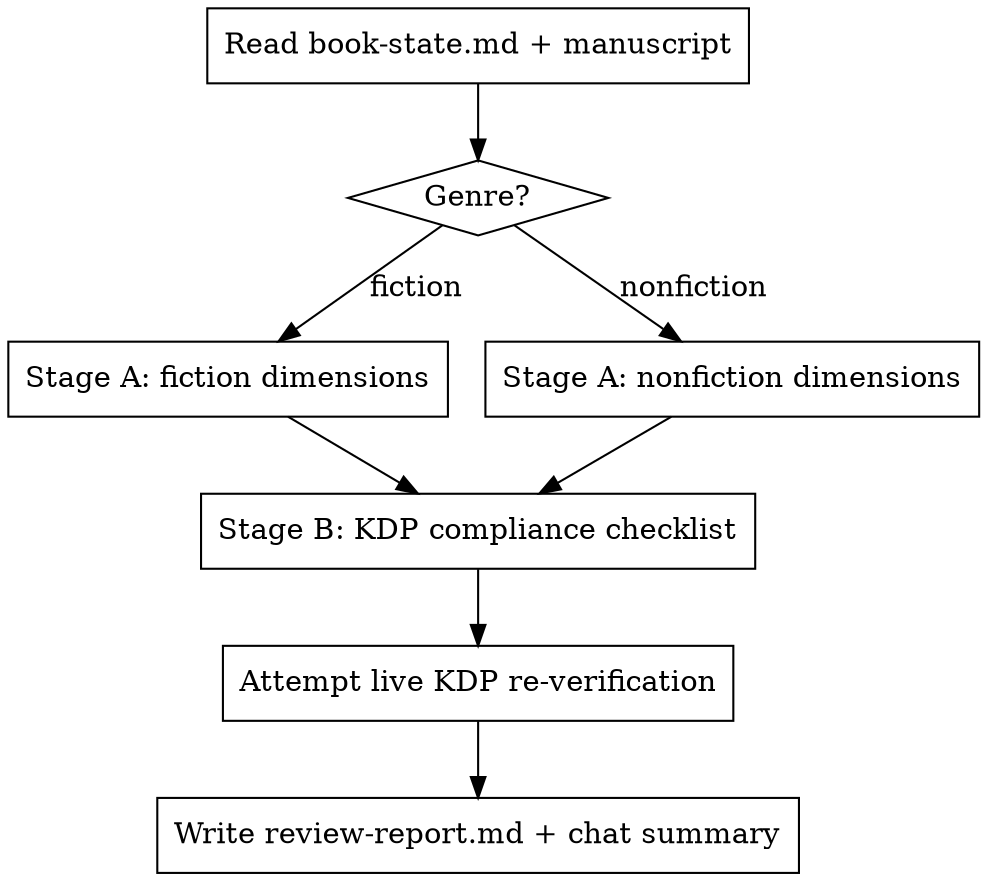

# Book Review

## Overview

A pre-publish gate for a manuscript, distinct from lighter drafting-time
passes (e.g. `kdp-book-writer`'s per-chapter 5-reader check). It runs two
separate evaluations and combines them into one report: **Stage A**, an
editorial review scored like a professional outlet (Kirkus / Publishers
Weekly / Foreword / IndieReader / Library Journal / Reedsy-style
developmental assessment), and **Stage B**, a KDP compliance checklist
(content policy, formatting, metadata, AI-disclosure, production quality).

**Not a pass/fail gate.** Output is a written report with a prioritized fix
list, not a GO/NO-GO verdict — the author decides when to publish.

## When to Use

- "Review my book" / "is this ready for KDP" / "check this manuscript"
- After a manuscript's chapters are all drafted and lightly reviewed, before
  hitting publish
- Re-run after fixes to confirm they landed
- **Not for:** reviewing a single chapter mid-draft — that's
  `kdp-book-writer`'s per-chapter 5-reader step. Use this once there's a
  substantially complete manuscript.

## Before You Start: Locate and Read the Manuscript

1. Find the book's folder and its `book-state.md` (topic, reader, format,
   tone, approved outline) — read it for context before scoring anything.
2. Find the actual manuscript text. It may not be plain prose: check for a
   non-prose source of truth too — a docx-generator script's embedded
   content, a CMS export, a spreadsheet. If the only reader-facing text
   lives inside a build script (e.g. Python dicts feeding a docx builder),
   that script IS the manuscript — read it directly rather than the binary
   it produces. If content only exists as `.docx` with no such source,
   extract plain text first (e.g. a short python-docx script, or
   `pandoc file.docx -o file.md`) rather than skipping content you can't
   open.
3. If there's a build/generation pipeline (scripts that produce the final
   docx/epub/pdf), read it too, not just the content. Claims you can't
   verify by opening the binary output (heading styles applied, font
   sizes, margins) can often be verified by reading the code that generates
   it instead.
4. Determine genre — fiction or nonfiction — from `book-state.md`'s Format
   field. If genuinely ambiguous, ask.

## Workflow

### Stage A — Editorial Review

Score each dimension on the anchored 1-5 scale (1 = really bad, 2 = mediocre,
3 = good/worth reading, 4 = very good, 5 = excellent; half-points allowed).
Full dimension list, anchors, and genre-specific branches (fiction vs
nonfiction) are in `references/editorial-review-rubric.md` — read it before
scoring.

**Every score below 4 requires a concrete example quoted or paraphrased from
the actual text, plus one actionable fix.** A dimension score with no
textual example is not a valid finding — generic criticism is exactly what
separates a form-letter review from a real one.

Close Stage A with a 150-250 word critic's-voice summary paragraph (context
+ unbiased verdict, in the style of a Kirkus/PW capsule review).

### Stage B — KDP Compliance Check

Checklist covering content policy, formatting, metadata, and production
quality. Full checklist is in `references/kdp-compliance-checklist.md`.

**Before using any number from that checklist** (character limits, DPI,
trim/margin tables), attempt to fetch the current official KDP help pages
and use live values instead. If the fetch fails or is unavailable, use the
bundled checklist values but mark every one you used as "not re-verified
live — confirm on kdp.amazon.com before publishing." Never present a
bundled number as current fact without that flag.

Mark each item **Pass / Needs fix / Not applicable**, with a one-line reason
for anything not a plain Pass.

**Quotation-heavy nonfiction (scripture, poetry, song lyrics, other quoted
source text):** spot-check quoted passages against known wording of their
likely source (e.g. a well-known Bible translation's phrasing) to identify
which copyrighted edition is being quoted, then check whether the
manuscript or its planned front matter contains the attribution/permission
notice that source requires. Flag a missing notice as a content-policy
"Needs fix," not just a formatting note — this is a real legal and KDP risk,
not a style preference.

### Report

Save `review-report.md` into the book's own folder, next to its
`book-state.md` (one file per book — never a shared root). Structure:

1. **Prioritized fix list** (top of file) — ordered by impact, each with a
   one-line "why it matters" and a one-line fix
2. Stage A dimension table + critic's summary
3. Stage B checklist

Then give a concise chat summary: the top 3-5 fixes and where the full
report was saved. Do not re-print the whole report in chat.

## Common Mistakes

- Scoring a dimension below 4 with no concrete textual example — the
  research behind this skill is unanimous that specifics are what
  distinguish a real review from generic praise/criticism
- Using bundled KDP numbers without attempting live re-verification, or
  presenting them as current fact when the fetch failed
- Confusing this with `kdp-book-writer`'s per-chapter 5-reader pass, or
  running it before the manuscript is substantially complete
- Applying fiction checks (character arc, POV, show-don't-tell) to
  nonfiction, or nonfiction checks (argument structure, evidence) to fiction
- Trying to "read" a `.docx` manuscript directly instead of extracting text
  first
- Producing a GO/NO-GO verdict — this skill reports; it doesn't gate
- Saving the report outside the book's own folder, or overwriting another
  book's report
