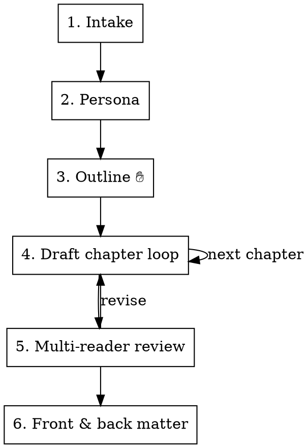

# KDP Book Writer

## Overview

A staged workflow for taking a book from a one-line topic to a publish-ready manuscript. The core principle: **lock structure before drafting prose, and gate every stage on the human's approval.** Most AI books fail because drafting starts before the outline is agreed, so chapters drift, repeat, and read generic.

This skill is the disciplined successor to the ACGFAF prompt-chain: same skeleton (intake → persona → outline → per-chapter prompts → multi-reader review), but with redundant steps merged, real approval checkpoints, a persistent state file, and a substantive quality rubric instead of a word/name blocklist.

## When to Use

- "Write me a book on X" / "ghostwrite a guide about X"
- Drafting or revising individual chapters of a longer manuscript
- Building or restructuring a table of contents
- Preparing a manuscript for Amazon KDP / ebook / paperback
- **Not for:** single articles, blog posts, or one-off short copy (overkill).

## The Workflow

Run the stages in order. **Do not advance past a checkpoint (✋) without explicit user approval.**



### 1. Intake (one pass, not four)

Collect in a single questionnaire. If the user already gave some, only ask for the gaps:

- **Topic & angle** — what the book is about and its unique take
- **Reader** — who it's for and the specific pain/goal it addresses
- **Outcome** — the transformation or payoff for the reader
- **Format** — guide / workbook / memoir / fiction / reference, etc.
- **Tone** — e.g. warm, authoritative, witty, clinical
- **Scope** — target word count, chapter count, paperback/ebook, visuals?

**Recommend on unknowns.** If the user can't answer a field, don't block — propose a sensible default for the genre (e.g. "guides in this niche usually run ~30k words / 10 chapters; want that?") and let them accept or adjust.

Create a dedicated folder for the book (one folder per book — never mix two books in one directory) and write the answers to its state file (see below).

### 2. Expert persona

Prime yourself as a named practitioner: "Write as a [role] with [N] years of real practice in [domain]." Use it to inform depth and vocabulary — not to add fake credentials into the text.

### 3. Outline ✋ CHECKPOINT

Generate a Table of Contents where each chapter has: a one-line **goal**, 3–5 **key topics**, and a **takeaway**. Chapters must escalate in value and not overlap. **Present it and stop. Get approval (or edits) before any drafting.** Save the approved outline to state.

### 4. Per-chapter draft loop

For each chapter, first build a tailored chapter prompt (the engine), then draft:

- Custom to that chapter's exact goal and topics
- In-depth, logically progressing sections under H1 (chapter) / H2 (sub-section) headings only
- Real, domain-grounded examples — not stock personas
- Ends with a reflection prompt, exercise, or reader takeaway
- Meets the chapter's word target; if output is cut by length, resume from the break — never skip a section

After each chapter: run the Quality Rubric (below), then mark it `drafted` in state.

### 5. Multi-reader review

Review the chapter (or book) as five readers — **beginner, skeptic, domain expert, teacher, casual reader.** For each: what works, the weakest spot with a concrete example, one actionable fix, and the impact of fixing it. Apply fixes, then mark `reviewed`.

### 6. Front & back matter

A manuscript isn't KDP-ready until it's wrapped. Once chapters pass review, produce:

- **Front matter** — title page, copyright page, and a hook-driven introduction that frames the reader's problem and the book's promise.
- **Back matter** — a closing/next-steps page, a review request ("if this helped, a quick Amazon review…"), and a short author bio.

## Quality Rubric (replaces the name/phrase blocklist)

Generic-sounding prose is a symptom of vagueness, not of specific banned words. Check each drafted section against:

| Check | Pass condition |
|-------|----------------|
| **Specificity** | Every claim carries a concrete detail, number, named referent, or worked example — not a generality. |
| **Sentence rhythm** | Sentence lengths vary; no run of 3+ structurally identical sentences. |
| **No filler** | Cut throat-clearing openers ("In today's world…", "It's important to note…", "Let me…", "Imagine…", "Consider…"). |
| **Grounded examples** | Examples come from the book's actual domain, not interchangeable stock scenarios or placeholder people. |
| **Voice** | Matches the declared tone consistently across the chapter. |
| **No padding** | No restating the heading, no hedging, no filler transitions between sections. |
| **No em dashes** | Never use the "—" (em dash) character in the manuscript prose. Use commas, periods, colons, or parentheses instead. Applies to all book text, headings, and captions. |

If a section fails: rewrite that section with concrete detail. Don't just swap names or delete a banned phrase — that treats the symptom.

## State File

Persist progress so a multi-session book survives context resets. Each book has its own folder; create `book-state.md` inside that book's folder (not a shared root):

```markdown
# <Book Title> — state
Topic: ...
Reader: ...
Outcome: ...
Format / Tone: ...
Word target: ... | Chapter target: ...

## Outline (approved <date>)
1. <Chapter> — goal | status: pending|drafted|reviewed
2. ...

## Style guide
- Tone notes, recurring terms, do/don't from review feedback
```

Read it at the start of any drafting session; update status after each chapter.

## Common Mistakes

- **Drafting before the outline is approved** — the #1 cause of drift. Honor the ✋ checkpoint.
- **Re-asking intake questions the user already answered** — read state first.
- **Treating "human-sounding" as a word blocklist** — use the rubric; vagueness is the real tell.
- **Losing the thread across sessions** — that's what the state file is for.
- **Letting chapters overlap** — each must add new value; check against the outline goals.
- **Shipping chapters without front/back matter** — a manuscript isn't KDP-ready until it's wrapped (Stage 6).
- **Mixing multiple books in one folder** — one folder per book, each with its own `book-state.md`.
